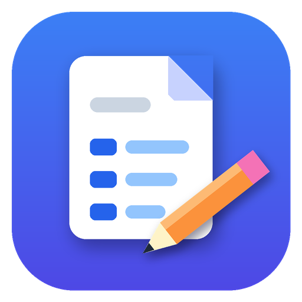
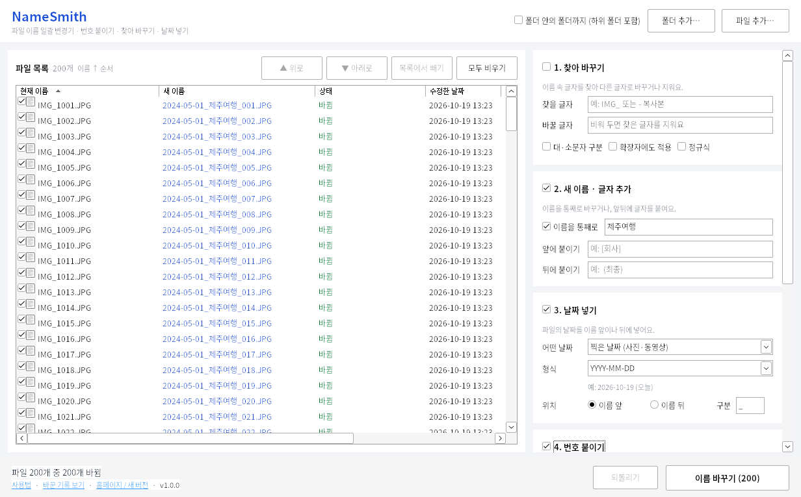

<p align="center">
  
</p>

<h1 align="center">NameSmith</h1>

<p align="center">
  <b>파일 이름 일괄 변경기</b> — 번호 붙이기 · 찾아 바꾸기 · 날짜 넣기로 수백 개 파일 이름을 한 번에<br>
  무료 · 광고 없음 · 인터넷 연결 없이 내 PC에서만 동작하는 Windows 프로그램
</p>

<p align="center">
  <a href="https://github.com/game-addicted-man/NameSmith/releases/latest"></a>
  
  <a href="LICENSE"></a>
</p>

<p align="center">
  
</p>

## 다운로드

👉 **[최신 버전 내려받기 (Releases)](https://github.com/game-addicted-man/NameSmith/releases/latest)**

| 파일 | 설명 |
| --- | --- |
| `NameSmith-Setup-x.y.z.exe` | **설치 버전 (추천)** — 시작 메뉴, 바탕 화면 바로 가기, 폴더 오른쪽 클릭 메뉴, 보내기 메뉴까지 한 번에 설정돼요. 관리자 권한이 필요 없어요. |
| `NameSmith-x.y.z-portable.zip` | **무설치 버전** — 압축을 풀고 `NameSmith.exe`를 바로 실행하면 돼요. USB에 넣고 다녀도 돼요. |

> **"Windows의 PC 보호" 창이 뜨면** `추가 정보` → `실행`을 누르세요.
> 코드 서명 인증서(유료)가 없는 무료 프로그램이라 처음 한 번 나오는 안내예요. 소스 코드는 이 저장소에 모두 공개되어 있어요.

## 주요 기능

- **번호 붙이기** — `001, 002, 003…` 시작 번호·증가값·자릿수·위치(앞/뒤)·구분 기호를 고르고, 폴더마다 번호를 새로 시작할 수도 있어요.
- **찾아 바꾸기** — `복사본`, `IMG_` 같은 글자를 찾아 바꾸거나 지워요. 대·소문자 구분, 확장자 포함, 정규식(고급)도 돼요.
- **날짜 넣기** — 수정한 날짜, 만든 날짜, **사진·동영상을 찍은 날짜**(JPG, HEIC, PNG, WebP, RAW, MP4, MOV), 오늘 날짜를 원하는 형식으로 넣어요.
- **새 이름 · 글자 추가** — 이름을 통째로 바꾸거나 앞뒤에 글자를 붙여요.
- **기타** — 대·소문자 바꾸기, 확장자 바꾸기/없애기, **맥에서 온 파일의 깨진 한글(ㅅㅏㅈㅣㄴ → 사진) 합치기**.
- **바꾸기 전에 미리 보기** — 바뀔 이름이 바로바로 보여요. 이름이 겹치거나 Windows에서 쓸 수 없는 이름이면 빨간색으로 알려 줘요.
- **수백·수천 개도 한 번에** — 폴더를 통째로 끌어다 놓으면 끝. 하위 폴더까지 넣을 수도 있어요.
- **되돌리기** — 잘못 바꿨다면 버튼 하나로 원래 이름으로 돌아가요.

## 사용법

1. **파일 넣기** — 파일이나 폴더를 창으로 **끌어다 놓거나**, `파일 추가…` / `폴더 추가…`를 누르세요.
   탐색기에서 폴더를 오른쪽 클릭 → **NameSmith로 이름 바꾸기**를 골라도 되고, 파일 여러 개를 고른 뒤 오른쪽 클릭 → **보내기 → NameSmith**를 골라도 돼요.
2. **바꿀 방법 고르기** — 오른쪽의 `1. 찾아 바꾸기` ~ `5. 기타` 중 필요한 것에 입력하세요. 입력하면 그 항목이 자동으로 켜지고, 왼쪽 목록의 **새 이름**이 바로 바뀌어 보여요.
3. **순서 정하기** — 번호는 목록 순서대로 붙어요. 열 제목(이름, 수정한 날짜, 크기, 폴더)을 눌러 정렬하거나 `▲ 위로` / `▼ 아래로`로 순서를 바꾸세요. 체크를 끈 파일은 건너뛰어요.
4. **이름 바꾸기** — 미리 보기가 마음에 들면 `이름 바꾸기`를 누르세요.
5. **되돌리기** — 실수했다면 `되돌리기`(Ctrl+Z)를 누르세요. 여러 번 되돌릴 수 있어요.

### 이렇게 쓸 수 있어요

| 하고 싶은 일 | 설정 | 결과 |
| --- | --- | --- |
| 여행 사진을 날짜순으로 정리 | 새 이름 `제주여행` + 날짜(찍은 날짜, 이름 앞) + 번호 | `IMG_1234.JPG` → `2024-05-01_제주여행_001.JPG` |
| "복사본" 지우기 | 찾을 글자 ` - 복사본`, 바꿀 글자 비움 | `보고서 - 복사본.docx` → `보고서.docx` |
| 강의 파일 정렬 문제 해결 | 찾아 바꾸기(정규식) `강의 (\d)\b` → `강의 0$1` | `강의 1.mp4` → `강의 01.mp4` |
| 회사 이름 붙이기 | 앞에 붙이기 `[회사] ` | `견적서.pdf` → `[회사] 견적서.pdf` |
| 확장자 통일 | 기타 → 확장자 `소문자로` | `IMG_0001.JPG` → `IMG_0001.jpg` |
| 스캔 문서 번호 매기기 | 새 이름 `계약서` + 번호(자릿수 2) | `scan0001.pdf` → `계약서_01.pdf` |

### 날짜 형식

`형식` 칸에서 고르거나 직접 입력하세요.

| 글자 | 뜻 | 예 |
| --- | --- | --- |
| `YYYY` / `YY` | 연도 | `2026` / `26` |
| `MM` / `M` | 월 | `05` / `5` |
| `DD` / `D` | 일 | `01` / `1` |
| `HH` / `H` | 시 (24시간) | `13` |
| `mm` | 분 | `45` |
| `ss` | 초 | `30` |
| `ddd` | 요일 | `월` |

예: `YYYY년 M월 D일` → `2026년 5월 1일`, `YYYYMMDD_HHmmss` → `20260501_134530`
(파일 이름에는 `:`를 쓸 수 없어서 시간은 `.`이나 `-`로 나눠 주세요.)

## 안심하고 쓸 수 있게

- **절대 덮어쓰지 않아요.** 같은 이름의 파일이 이미 있으면 그 파일은 건너뛰어요.
- **이름을 서로 맞바꾸는 경우**(A→B, B→A)나 대·소문자만 바꾸는 경우도 임시 이름을 거쳐 안전하게 처리해요.
- 바꾸는 도중 전원이 꺼져도, 다음에 실행할 때 **남은 작업을 마저 정리**해요.
- 바꾼 내용은 `바꾼 기록 보기`(아래쪽 링크)에 CSV 파일로 남아요. 엑셀로 열어 볼 수 있어요.
- 숨김 파일·시스템 파일(desktop.ini, Thumbs.db 등)은 폴더를 넣을 때 자동으로 빠져요.
- 파일 내용은 건드리지 않아요. 인터넷에 아무것도 보내지 않아요.

## 자주 묻는 질문

**Windows 11에서 폴더 오른쪽 클릭 메뉴에 안 보여요.**
Windows 11은 오른쪽 클릭 후 `더 많은 옵션 표시`(Shift+F10)를 누르면 나와요.

**설정은 어디에 저장되나요?**
`%APPDATA%\NameSmith\settings.json`에 마지막으로 쓴 설정이 저장돼요. 기록은 `%LOCALAPPDATA%\NameSmith\기록`에 있어요.

**지우고 싶어요.**
설치 버전은 `설정 → 앱 → 설치된 앱`에서 NameSmith를 제거하세요. 무설치 버전은 폴더를 지우면 끝이에요.

**문제가 생겼어요 / 기능을 제안하고 싶어요.**
[Issues](https://github.com/game-addicted-man/NameSmith/issues)에 남겨 주세요.

## 직접 빌드하기

필요한 것: [Go 1.24 이상](https://go.dev/dl/), (설치 파일을 만들려면) [Inno Setup 6](https://jrsoftware.org/isdl.php)

```powershell
git clone https://github.com/game-addicted-man/NameSmith.git
cd NameSmith
go test ./internal/...
go build -trimpath -ldflags "-s -w -H windowsgui" -o dist\NameSmith.exe .\cmd\NameSmith
& "${env:ProgramFiles(x86)}\Inno Setup 6\ISCC.exe" installer\NameSmith.iss   # dist\NameSmith-Setup-*.exe
```

- 필요한 라이브러리는 `vendor/` 폴더에 들어 있어서 인터넷 없이도 빌드돼요.
- 다른 OS에서도 `GOOS=windows`로 빌드할 수 있어요 (CGO가 필요 없어요).
- `main`에 올릴 때마다 GitHub Actions가 Windows에서 빌드·테스트해요. `VERSION` 파일의 버전을 올려서 push하면 설치 파일과 무설치 zip이 새 Release로 자동 게시돼요.

| 폴더 | 내용 |
| --- | --- |
| `internal/engine` | 이름 만들기 규칙, 겹침 검사, 안전한 이름 바꾸기·되돌리기 |
| `internal/meta` | 사진·동영상에서 찍은 날짜 읽기 (EXIF, HEIC, MP4/MOV) |
| `internal/ui` | Windows 화면 ([walk](https://github.com/tailscale/walk)) |
| `installer` | Inno Setup 설치 스크립트 |
| `build` | 아이콘, Windows 리소스(.syso) 생성 도구 |

## 라이선스

[MIT](LICENSE) © 2026 Jonghoon Lee
